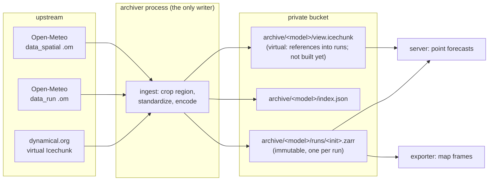

# Self-hosted Zarr forecast archive

Reference for upslope's own archive of gridded forecast data: per-run Zarr stores in our bucket, written from
upstream model data in a standard schema, read by point forecasts and (optionally) the map exporter. This
describes the architecture and why it is shaped this way; it is not a work plan. Numbers come from benchmarks
run on 2026-11-23 (see [Benchmarks](#benchmarks)); re-measure before relying on them for a decision.

## Why own the data

Point forecasts need many variables from many models at one location, fast (well under a second), with the
same meaning in every model. Reading upstream at request time doesn't meet that:

- **dynamical.org virtual datasets** reference the original GRIB files, so every lead time of a point series is
  a full-field download and decode: 11–19 s per field.
- **dynamical.org materialized datasets** are point-friendly (0.6–1.7 s per field from a cold process), but
  they lack fields (e.g. `geopotential_height_0c_isotherm`) and models (RRFS), lag the model runs by hours
  (HRDPS about 4.5 h), and are uneven (HRDPS reads took 8–10 s per field). A forecast is only as fast as its
  slowest field: one missing field sends the whole model back to the virtual store.
- **Open-Meteo's open data** has fast point reads (about 320 ms for 12 variables, nothing cached), but its
  variables differ by model (no freezing level outside HRRR; no `temperature_2m` in `ncep_gfs025` run files),
  its region reads through the Python reader take 15–35 s, and its run files lag the model runs by 2–8 h.

Owning the data fixes these where it counts: every variable of every model in one store, in one schema, chunked
for our reads, next to our server. **Standardization is the main point.** Each source's quirks (units,
accumulation conventions, missing-value conventions, variable names) are resolved once at ingest, so readers
never see them.

## Overview



- **Ingest** runs in its own process, the archiver (`upslope archive-loop`, the `archiver` Fly process group),
  apart from the exporter so decoding model data never delays map frames. It is the only writer to the archive;
  everything else only reads it. (It may later be folded into the exporter, if the map renders from the
  archive.)
- **Each model run is its own Zarr v3 store.** It is written once and never changed, then published by
  listing it in the model's `index.json`.
- **A virtual Icechunk repository per model** combines that model's runs into one
  `(init_time, lead_time, y, x)` dataset without copying data.
- The archive lives in the **private bucket** (`BUCKET_NAME`). Browsers never read it; the server answers point
  requests, and the exporter renders map frames into the public bucket as it does today.

## Sources

Ingest has one adapter per kind of source. Each adapter knows how to find a model's runs, how to tell whether a
run is complete, and how to read a region of one variable for every lead time.

| Source | What it is | Freshness | Ingest cost |
| --- | --- | --- | --- |
| dynamical.org virtual | Icechunk references into NOAA/ECMWF GRIB files | Fills in as the model publishes | Every (variable, lead) is a full-grid GRIB download and decode, whatever the region |
| dynamical.org materialized | Rechunked Zarr | Hours behind; only complete runs | Region reads; cheaper, but missing fields and models |
| Open-Meteo `data_run/<model>/<YYYY/MM/DD/HHMMZ>/<var>.om` | One file per variable per run, `(y, x, time)`, time-series chunks (HRRR: `(1, 20, 49)`) | Written last, after Open-Meteo's own update; keeps at most one run per 3 h, for 3 months | Download the whole file (HRRR CONUS: 53 MB, about 1 s), crop locally. Range-reading a region is far slower |
| Open-Meteo `data_spatial/<model>/<run>/<time>.om` | One file per valid time, every variable (268 for HRRR), 32×32 chunks | In-progress runs included (`in-progress.json`); 7 days kept | 107 MB per HRRR valid time; only worth it for freshness |

The Open-Meteo bucket is `s3://openmeteo` in us-west-2 (CC BY 4.0). Run-file lag measured at about 20:30Z on
2026-11-23:

| Open-Meteo model | Latest run file | Written | Lag | Freezing level |
| --- | --- | --- | --- | --- |
| `ncep_hrrr_conus` | 18Z | 19:51 | ~2 h | yes |
| `cmc_gem_hrdps` | 12Z | 17:23 | ~5 h | no |
| `ecmwf_aifs025_single` | 12Z | 17:39 | ~6 h | no |
| `ecmwf_ifs025` | 12Z | 20:05 | ~8 h | no |
| `ncep_gfs013` | 06Z | 11:21 | 12Z still missing at ~20:30Z | no |

Open-Meteo is the only source here for ECMWF IFS (0.25° only; the 9 km IFS is in its historical archive, not
its forecasts) and for NBM. RRFS is only on dynamical.org. UW WRF publishes images only, so it can't be
archived and has no point forecasts.

## Standard schema

Every run store follows one schema, whatever its source. The schema is the contract that point forecasts (and
later the map) are written against.

- **Variable names and units** are upslope's own, not the source's (for example `temperature_2m` in °C,
  `precipitation` in mm). A model that can't provide a variable leaves it out; it is never approximated
  silently.
- **Accumulations are converted to a single meaning at ingest:** the amount (or mean) over the interval ending
  at that lead time, since the variable's previous lead time with data. Run totals, "since the last 6-hour reset"
  averages and mean rates are all differenced or integrated into per-interval values
  (`python/upslope/archive/conversions.py`). Summing a variable over any span of lead times gives that span's
  total, even where a model's accumulation step is longer than the lead axis (NBM's 6-hourly precipitation
  after 36 hours leaves the 3-hourly leads between empty). Lead 0 is missing for accumulations.
- **Missing-value conventions are normalized.** For example, freezing level at or below the ground is reported
  as 0 by GFS, NaN by HRRR and a negative height by RRFS; the archive stores one convention.
- **Wind is stored as earth-relative u/v** (HRRR and RRFS components are grid-relative upstream and need
  rotating), so speed and direction can both be derived.
- **Model terrain is stored with every run** (`surface_height`, whole metres). At mountain points, model terrain can
  be far below the real elevation. At Camp Muir, GFS gave 34.5 °F and HRRR 8.7 °F for the same hour. The terrain
  height is what allows an elevation adjustment. It comes from the model's own surface height field where the source
  publishes one (HRRR, RRFS, GFS, AIFS), else from Open-Meteo's static height for the same model (HRDPS, IFS, NBM),
  checked to be on the same grid. It's kept in each run, not a separate static store, so it always matches the run's
  grid and needs no lifecycle of its own; it costs well under 1 MB per run. A land mask is still planned.
- **Encoding:** int16 values in fixed steps per variable, decoded with CF `scale_factor` (and `_FillValue`
  -32768 for missing data). This is the same idea as the `values: {step, min, max}` of `config/models.yaml`, and
  Open-Meteo stores its data the same way. Blosc zstd level 5 with byte shuffle. The measured size is 0.5–0.7
  bytes per value, almost independent of chunk layout.

## Storage layout

```
archive/status.json                           the archiver's last check
archive/<model>/index.json                    the model's runs, newest first (the newest is its latest run)
archive/<model>/runs/<YYYYMMDDTHH>.zarr/      one run (Zarr v3, consolidated metadata)
    zarr.json                                 group attrs: model, init_time, source, config fingerprint,
                                              layout version, attribution
    lead_time/  init_time/  y/  x/            coordinates (1-D; the grid is regular in its own CRS)
    spatial_ref/                              grid CRS (WKT) and GeoTransform
    <variable>/c/0/0/0                        a shard: (lead_time, y, x) int16
    surface_height/                           the model's terrain: (y, x) int16 metres
archive/<model>/view.icechunk/                virtual multi-run view (planned; see below)
```

- **`lead_time` always has the model's full length.** A short run (e.g. an 18-hour HRRR run) or an in-progress
  one is NaN-filled. All of a model's runs then have identical chunk shapes, which is what lets them be combined.
- **The grid is the model's native grid, cropped to the model's region,** never reprojected. A point's cell is
  computed in closed form from the 1-D coordinates, the way `grid_window` already does for the map.
- **The region is per model, in config,** and is a superset of the map's `region`. Growing it only affects
  new runs.

## Chunking

Within a store, each variable is one array `(lead_time, y, x)`, and each array is one shard object. The
shard's inner chunks are the unit of reading. Two kinds of read matter:

- **point:** every lead at one cell, for a dozen variables;
- **map:** one lead over the whole region (a frame), or every lead (rendering a whole run).

Measured on a full HRRR run cropped to the upslope region (383 × 432 cells, 49 leads). "Warm" means the server
has already opened the run store and holds its coordinates and shard indexes; times use a simulated 15 ms
round trip (see [Benchmarks](#benchmarks)).

| Inner chunk (leads, y, x) | Point, 12 vars | Map, 1 var 1 lead | Map, 5 vars 1 lead | Bytes per map read |
| --- | --- | --- | --- | --- |
| `(49, 8, 8)`: time-optimized | **22 ms** | 450 ms | 1,390 ms | 7.0 MB |
| `(1, 128, 128)`: space-optimized | 184 ms | **35 ms** | **33 ms** | 0.46 MB |
| `(12, 32, 32)` | 32 ms | 199 ms | 220 ms | 6.6 MB |
| **`(6, 64, 64)`: the default** | **49 ms** | **83 ms** | **81 ms** | 3.4 MB |

**The default is `(6, 64, 64)` inner chunks, one shard per variable per run.** It is within about 2× of the
specialized layout for both kinds of read, so the archive is written once rather than in a time-optimized
copy and a space-optimized copy.
- **Point:** nine chunk reads per variable (49 leads ÷ 6), merged into about two range requests.
- **Map:** a 6-lead block of the region per frame.

Things the numbers show:

- **Request count matters more than bytes for points; decode CPU matters more for maps.** Time-optimized
  chunks are only 12.5 KB, but a whole-region read decodes about 2,600 of them, and zarr-python's per-chunk
  overhead dominates (450 ms on a laptop CPU, with no network at all).
- **Whole-run reads cost about the same in every layout:** 250–500 ms per variable. Rendering every frame of a
  run (what the exporter does today) is cheap in every layout.
- **Coarse global models don't care.** For IFS 0.25° (35 × 57 cells, 85 leads) every layout is under 40 ms
  warm.
- **Larger regions:** at CONUS scale, a single shard per variable becomes about 1 GB for HRRR. Shard spatially
  instead (e.g. 512 × 512 cells by all leads) and keep the same inner chunks; point reads still touch one shard.
- **Shard indexes:** zarr-python doesn't cache them. Because run stores never change, a server can cache each
  index (a few KB) for the life of the run, which removes one round trip from every read.

## Lifecycle and consistency

- **Write order:** ingest writes every shard, then each array's metadata, then the consolidated root
  `zarr.json`, then lists the run in `index.json` (and, later, rebuilds the virtual view). A reader that follows
  the index never sees a partial run, without any transactions.
- **Run stores are immutable** once listed. Readers can cache metadata, coordinates and shard indexes for good.
  A config change (the fingerprint in the index and the group attrs) re-archives the kept runs a few per check:
  each is dropped from the index, replaced, and listed again. The layout version in the group attrs keeps the
  virtual view from mixing incompatible runs.
- **In-progress runs:** the simple form ingests a run once it is complete, which is how the map driver picks
  runs today. For fresher points, a run can be rewritten as more leads land. A shard per variable is a few MB,
  so rewriting is cheap, and readers see either the old or the new shard object. Until the run is complete,
  the index and the view point at the previous one. (Only complete runs are archived for now.)
- **Retention is a number of runs per model** (`keep_runs`, 8 by default). Point forecasts need the newest
  complete run; older runs are for comparing runs. To expire a run, drop it from the index (and the view), then
  delete its prefix.

## Multi-run view (comparing runs)

*Planned, not built yet: the prototype below showed it works; it is deferred until comparing runs is needed.*

To compare how successive runs forecast the same valid time (dProg/dt), a model's runs are combined into one
dataset with an `init_time` dimension, using an **Icechunk repository of virtual chunks**:

- The repository holds the coordinates (`init_time`, `lead_time`, `y`, `x`) as ordinary arrays.
- Each variable is an unsharded array `(init_time, lead_time, y, x)` whose chunk shape and codecs are the run
  stores' *inner* chunk and codecs.
- Every chunk is a virtual reference `(run shard object, offset, length)`, read from the end of that run's shard
  index. Empty chunks (index entry `2^64-1`) have no reference and read as the fill value.
- Data is never copied. For 3 runs of 3 HRRR variables, the repository was 63 KB (3,276 references) and took
  0.04 s to build.
- It is **rebuilt from scratch for each new run** and committed as a new snapshot. With 20 variables and about
  8 runs that is still a few MB, so there is no need to append to or trim the `init_time` axis (the hard part
  of a rolling archive in Zarr).

In the prototype, the view returned exactly what reading the runs directly returned. Reads across runs were as
fast or faster: 3 ms for a point at one valid time across 3 runs, 30 ms for the region. The manifest already
holds every chunk's offset, so the view never reads shard indexes and each chunk is one request.

Constraints:
- every run in a view must have the same chunk shapes and codecs (hence the fixed `lead_time` length and the
  layout version);
- the view's virtual chunk container must name the bucket's endpoint explicitly (the same problem
  `pin_aws_endpoints` solves for dynamical's containers);
- old snapshots of the view must be expired now and then. They are tiny, and expiring them never touches the
  run data.

The alternative, opening each run's store and reading the right lead from each, also works. It costs a few round
trips per run unless the server caches each store's metadata (it would). Note that `xr.concat` on lazily opened
stores (without dask) loads them into memory, so it is not a lazy view.

## Decisions

**Plain Zarr for runs, Icechunk only for the combined view.** Icechunk's strengths are transactional commits,
version history and appending to one long-lived dataset. That is what dynamical.org needs for a multi-year
archive. Immutable per-run stores get consistency from write order and retention from deleting prefixes, without
adding a manifest round trip to every cold read or garbage collection to the write path. Icechunk is used where
it is uniquely useful: references that tie many runs into one dataset at no storage cost. Reconsider a fully
Icechunk-native archive if upslope ever keeps a long history (for example, to verify forecasts against
observations).

**Not COGs.** A COG per lead time is spatial, so a point series means one request per lead (49–209 per variable).
A pixel-interleaved multi-band COG can put a point's whole series in one tile, but that is Zarr chunking with
less convenient tooling, and it doesn't extend to an `init_time` dimension. GeoTIFFs stay where they fit: the
map's rendered frames and value files.

**One layout, not two copies.** Storage is cheap enough for two copies (time-optimized and space-optimized), but
`(6, 64, 64)` gets within about 2× of each. A second copy would double ingest writes and the lifecycle logic for
little gain.

**Download, don't range-read, Open-Meteo for ingest.** Range-reading a region from Open-Meteo files took 15–35 s
per variable. Downloading the whole file takes about 1 s per variable at CONUS scale. Cropping locally is
negligible.

## Size estimates

Measured: 0.56 bytes per value for HRRR and 0.66 for IFS, with int16 steps and Blosc zstd. About 20 variables
per model, upslope region `[-127, 41.5, -113, 50]`:

| Model | Cells × leads | Per run | Long runs per day | Per day |
| --- | --- | --- | --- | --- |
| HRRR 3 km | 165k × 49 | 90 MB (measured) | 4 | 360 MB |
| RRFS 3 km | ~165k × 85 | ~160 MB | 4 | ~640 MB |
| HRDPS 2.5 km | ~240k × 49 | ~130 MB | 4 | ~520 MB |
| GFS 0.25° | 2k × 209 | ~5 MB | 4 | ~20 MB |
| IFS 0.25° | 2k × 85 | 1.9 MB (measured, 17 vars) | 2–4 | <10 MB |
| AIFS 0.25° | 2k × 61 | ~1.5 MB | 4 | ~6 MB |

That is about 1.5 GB per day across models, so keeping 8 runs per model (2 days of 6-hourly runs) is about
3 GB. That is well under $1 a month of object storage. The cost is in ingest rather than storage:
- HRRR from Open-Meteo downloads 827 MB of CONUS files per run for 20 variables (64 s here);
- from dynamical's virtual store, it is about 1,000 full-grid GRIB messages per run.

At CONUS scale, HRRR alone is about 11× larger (1.9M cells, about 1 GB per run).

## Read paths

- **Point** (server): resolve the model's run (`index.json`, polled), then compute the cell from the grid
  coordinates. Read each variable's series concurrently: one range request each, once the store's metadata,
  coordinates and shard indexes are cached. Derived quantities (wind speed, 3-hour totals, elevation adjustment)
  are computed at read time from standard variables. The zarr reads are async (zarr-python v3), and decoding is
  blocking work, so it goes to a thread like the server's other blocking calls.
  - As built, the server keeps each model's newest run on local disk and reads a point's cell straight from the
    shard files (`upslope/archive/shards.py`): shard indexes are loaded once per run, then one `pread` and one Blosc
    decode per inner chunk. zarr-python's per-call overhead was about 85% of a 45–90 ms read per model; read
    directly, HRRR takes about 6 ms and GFS about 13 ms. Arrays in any other layout fall back to zarr.
- **Map** (exporter, optional): read one shard per variable for the run (all leads in one or two requests), then
  render frames as today. Exporting reads upstream once (ingest) instead of once per frame.
- **Comparing runs**: read through the view (`init_time` × `lead_time`), or per run.

## Benchmarks

Code lives outside the repo in `~/sandbox/fx_benchmark` (dynamical.org) and `~/sandbox/zarr_benchmark`
(Open-Meteo, prototype archive, virtual view). All runs were from a laptop.

- **dynamical.org** (`point_forecast.py --benchmark 2`, Camp Muir, 5 models, 7 variables, 168 h): about 22 s to
  the full forecast.
  - Store opens: 1.1–2.3 s each; `noaa-gfs-forecast-virtual` 12–18 s.
  - Materialized reads: 0.6–1.7 s per field (HRDPS 8–10 s).
  - Virtual reads: 11–19 s per field.
  - `main_fixed.py` hung for over 5 minutes opening the materialized HRRR store.
- **Open-Meteo** (`bench_openmeteo.py`, HRRR 18Z, 48 ms round trip to us-west-2):
  - Points: 238 ms for 1 variable and 318 ms for 12 with nothing cached; 170 ms for 12 with readers cached.
  - Regions: 15–18 s for one valid time from `data_spatial`; 35 s from `data_run`.
- **Prototype archive** (`build_prototype.py`, `bench_zarr.py`):
  - **Method:** stores on local disk behind a wrapper that counts requests and adds a simulated round trip
    (0, 15 or 48 ms) plus transfer time (50 MB/s per request) to each request, with concurrent requests
    overlapping.
  - **The 15 ms figure for a server next to its bucket (Fly to Tigris) is assumed, not measured.** Measuring it
    from a Fly machine is the first thing to check before trusting the absolute numbers.
  - **Cold point reads** (open the store, read coordinates, index, chunk) were about 105–130 ms at 15 ms and
    300–340 ms at 48 ms in every layout except space-optimized. Warm results are in the chunking table above.
- **Multi-run view** (`bench_virtual.py`): HRRR 06Z, 12Z and 18Z, 3 variables. Results are in the view section.

## Known limits

- UW WRF can't be archived (images only), so the default map model has no point forecasts.
- Each source has a different set of variables; the schema has to accept that a model may lack a variable.
- Open-Meteo run files arrive hours after the model runs. Fresher ingest means `data_spatial` (large) or
  dynamical's virtual stores (a download per field and lead).
- Map-frame read times are mostly zarr-python decode CPU, measured on a laptop. A shared-CPU Fly machine will
  be slower.
